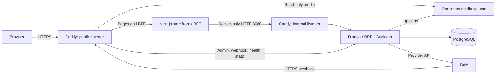

# Naghsh-e Jahan

A full-stack ecommerce platform for Iranian handicrafts, with a Persian RTL
storefront inspired by Isfahan. Customers can browse products, manage a cart,
check out, resume eligible payments, follow their orders, and submit reviews.
Store operators have a dedicated operations dashboard and a Django Admin back
office.

The project combines a **Django/DRF commerce backend**, **PostgreSQL**, and a
**Next.js App Router storefront with a same-origin BFF**. Its engineering focus
is preserving correct order, inventory, payment, and authorization state when
requests overlap, fail, or are repeated.

**Status:** v1.0.0 source-release candidate. Local verification has passed for
the implementation baseline; GitHub CI for the final release revision remains
to be verified. Public deployment and live Bale payments are not claimed.

## Implemented capabilities

| Area | Implemented behavior |
| --- | --- |
| Catalog | Categories, product detail and images, search, filters, sorting, pagination, approved-review averages and counts |
| Customer accounts | Email login and registration, profile editing, owned addresses and default-address selection |
| Cart and checkout | Persistent guest/customer carts, explicit cart merge after login, stock revalidation, order and address snapshots, temporary inventory reservations |
| Orders and payments | Owned order history/detail, eligible payment resumption, generic payment-URL and Bale Mini App handoffs, server-authoritative payment results |
| Product reviews | One review per customer/product, moderation-status display, deletion, approved public reviews and one official store reply per review |
| Store management | Order metrics, fulfillment transitions, shipment details, cancellation, manual refund resolution, review moderation and replies through permission-checked APIs and dashboard |
| Technical back office | Catalog/media administration, reservation-aware stock correction, read-only payment/audit records and domain-backed order actions |

The customer cancellation API is implemented; the storefront does not yet expose
a customer cancellation control. Django Admin uses Persian RTL presentation and
Solar Hijri dates for read-only display, while editable dates retain Django's
Gregorian parsing.

## Architecture and stack

| Layer | Technologies and responsibility |
| --- | --- |
| Commerce API | Python 3.12, Django 5.2, DRF, SimpleJWT and drf-spectacular; domain rules and authorization |
| Data | PostgreSQL; relational constraints, row locks, snapshots and durable payment records |
| Storefront/BFF | Node.js 24, Next.js, React, TypeScript and Tailwind CSS; rendering, interaction and browser-cookie boundary |
| Runtime | Docker Compose, Gunicorn, WhiteNoise and Caddy; separate development and single-VPS production configurations |
| Verification | pytest/pytest-django, Ruff, ESLint, TypeScript, Node test runner, dependency audits and GitHub Actions |



This diagram reflects [production Compose](compose.production.yaml) and its
[Caddy configuration](deploy/Caddyfile). The two Caddy nodes are listeners in
**one container**. The internal listener normalizes the public host, HTTPS
scheme and trusted client IP for BFF requests. Only Caddy publishes production
host ports; the database uses an internal Docker network.

Django owns prices, totals, inventory, lifecycle transitions and payment truth.
Next.js renders data and handles browser credentials; it does not reproduce
commerce rules. The catalog and account pages use Server Components, with
Client Components for forms, cart updates, payment handoff and operator actions.

```text
backend/                 Django apps, tests, settings and Python dependency locks
frontend/                Next.js storefront, BFF routes and frontend tests
compose.yaml             Local development stack
compose.production.yaml  Single-VPS production stack
deploy/                  Caddy configuration and operational helpers
```

## Engineering highlights

### Checkout and inventory under concurrency

[Checkout](backend/apps/orders/services.py) locks and revalidates the customer,
cart, address and products inside a transaction, then creates immutable order
snapshots and reservations. Reservations reduce availability without changing
physical stock. [Payment finalization](backend/apps/payments/services.py)
deducts stock and consumes reservations once; paid cancellation restores stock
once. PostgreSQL-backed [concurrency tests](backend/apps/orders/tests/test_cancellation.py)
exercise competing cancellation and payment requests using separate connections.

Catalog editing follows the same consistency requirements: the
[product Admin](backend/apps/products/admin.py) uses partial saves for changelist
status edits so stale instances cannot overwrite a concurrent stock deduction.
Full stock corrections retain locking and active-reservation validation.

### Lifecycle, fulfillment and auditability

The [order lifecycle](backend/apps/orders/lifecycle.py) defines explicit allowed
transitions, lifecycle timestamps and actor-attributed history. Operator retries
succeed only when the locked order and persisted history prove the same completed
action by the same actor. A shipment is created when processing starts, requires
carrier/tracking details before shipping, and becomes immutable afterward.
Refunds are tracked as a manual workflow rather than simulated gateway refunds.

### Payment failure handling and recovery

Payment intent is persisted before provider calls, and network requests occur
outside long-lived database locks. A small [gateway interface](backend/apps/payments/gateways.py)
separates provider communication from finalization. Durable
[Bale webhook records](backend/apps/payments/bale_webhooks.py) support replay
handling and the existing recovery command. Provider-authoritative late success
is recorded without reviving a cancelled/expired order or deducting stock again;
it instead requires refund follow-up. Client callbacks never prove payment.

### Authentication and the browser boundary

The BFF keeps JWTs and guest-cart credentials in HttpOnly cookies, enforces
exact-origin checks on mutations, and marks personalized responses private and
no-store. Customer and management sessions use separate cookies; Django still
checks ownership and explicit model permissions for every protected operation.

[Refresh coordination](frontend/src/lib/auth-refresh.ts) coalesces rotating-token
requests in process. Definitively rejected refresh credentials invalidate a
session; rate limits and temporary failures preserve cookies and stop the
protected request. Ambiguous rotation is not automatically retried within a
request. Multi-process coordination remains a deployment limitation, documented
in the [authentication contract](FRONTEND_HANDOFF.md#authentication-and-account).

### Database guarantees and executable specifications

[Database constraints](backend/apps/orders/models.py) enforce important rules
such as valid money/state and one reservation per order/product. Conditional
uniqueness also covers active carts, pending payment attempts, primary images
and default addresses. Category parent changes use a PostgreSQL advisory lock
to prevent concurrent cycle creation.

Tests cover permissions, ownership hiding, actor-specific replay, rollback,
late payment success, Admin concurrency and bounded query counts. BFF integration
tests run real Next.js handlers against a controlled HTTP upstream; they are not
live-provider or public-deployment tests.

## Run locally

Install Docker Engine/Desktop with the Compose plugin. Commands run from the
repository root; host Python and Node.js are not required for this workflow.

```bash
cp .env.example .env
# Replace the development secrets in .env before starting.
docker compose up --build
```

On PowerShell, use `Copy-Item .env.example .env` for the copy step.

| Interface | Local URL |
| --- | --- |
| Storefront | http://localhost:3000 |
| Operations dashboard | http://localhost:3000/dashboard |
| Django Admin | http://localhost:8000/admin/ |
| API documentation | http://localhost:8000/api/docs/ |
| OpenAPI schema | http://localhost:8000/api/schema/ |

In another terminal, create an administrator and add categories, products and
images through Django Admin:

```bash
docker compose exec web python manage.py createsuperuser
```

No sample catalog or payment simulator is bundled. The copied environment file
selects Bale, but credentials and a public webhook are required for payment
integration. To evaluate catalog, accounts, carts and checkout without Bale,
set `PAYMENT_GATEWAY_CLASS=apps.payments.gateways.UnavailablePaymentGateway` in
`.env`; payment initiation then fails safely until a provider is configured.
See the [development-only Bale smoke flow](OPERATIONS.md#manual-bale-test-payment-smoke-test)
for the external integration prerequisites.

Development Compose applies migrations on startup and bind-mounts source for
reloads. Linux `node_modules` and `.next` use named volumes. Production migrations
are a separate release operation. Environment variables are documented in
[.env.example](.env.example) and [.env.production.example](.env.production.example).

## Test and verify

Run against development or disposable PostgreSQL, never a production database.
The backend suite creates a separate test database and includes real concurrency
tests; SQLite is not a substitute. For release verification, isolate PostgreSQL
and use disposable containers without project data volumes.

```bash
# Backend
docker compose run --rm web pytest
docker compose run --rm web ruff check .
docker compose run --rm web ruff format --check .
docker compose run --rm web python manage.py check
docker compose run --rm web python manage.py makemigrations --check --dry-run
docker compose run --rm web python manage.py migrate --check
docker compose run --rm web python manage.py spectacular --file /tmp/schema.yaml --validate

# Frontend
docker compose run --rm --no-deps frontend npm run lint
docker compose run --rm --no-deps frontend npm run typecheck
docker compose run --rm --no-deps frontend npm test
docker compose run --rm --no-deps frontend npm run test:integration
docker compose run --rm --no-deps frontend npm audit --omit=dev --audit-level=low
docker compose run --rm --no-deps frontend npm audit --audit-level=high

# Production image builds
docker build -t ecommerce-api ./backend
docker build --target production -t ecommerce-frontend ./frontend

git diff --check
```

The [CI workflow](.github/workflows/ci.yml) installs committed lockfiles, checks
TypeScript from a clean generated state, runs both suites, validates migrations
and OpenAPI, checks production security settings and builds both images. It
installs `pip-audit==2.10.1` separately and runs strict audits of both Python
locks. npm runtime audits fail on any severity; the full npm audit fails on High
or Critical findings. The workflow has no advisory exception and runs on pushes
to `main` and pull requests targeting `main`.

## Deployment and release status

The [single-VPS runbook](DEPLOYMENT_VPS.md) covers Ubuntu, Docker Compose, Caddy
HTTPS, persistent PostgreSQL/media volumes, explicit migrations, backup/restore
and scheduled JWT cleanup. The [operations reference](OPERATIONS.md) preserves
configuration, runtime, proxy/throttle and Bale integration details.

Both application images run as non-root users. Production uses environment
validation, HTTPS enforcement, manifest-hashed static assets, health probes and
rotating container logs. Logs are separate from append-only domain audit records.

Local release verification of implementation commit
`921cedd7950ab256322413b6933325110f2a7046` passed backend/frontend checks,
strict dependency audits, production image builds and isolated health smoke
checks. This is local evidence, not a GitHub Actions result. CI for the final
release revision remains an outstanding release gate.

Known limitations and unverified work:

- No public deployment or successful live Bale payment is claimed. DNS/TLS,
  provider delivery and the full Mini App flow need deployment-environment QA.
- In-process refresh coordination and local-memory throttles are not global
  across workers/replicas. Revisit both before scaling.
- Single-VPS media persistence is configured; encrypted off-server backups,
  monitoring/alerts, restore drills and capacity sizing remain operator work.
- Mobile filter focus wrapping and mobile-menu focus restoration remain known
  accessibility follow-ups; no exhaustive WCAG certification is claimed.
- Customer tracking/history/refund detail fields, automatic or partial refunds,
  returns, multiple shipments and warehouse/carrier integrations are outside the
  current scope. See [integration boundaries](FRONTEND_HANDOFF.md#integration-responsibility-classification)
  and [release notes](CHANGELOG.md).

## Documentation and license

- [Frontend integration contracts](FRONTEND_HANDOFF.md)
- [Single-VPS deployment runbook](DEPLOYMENT_VPS.md)
- [Operations and Bale reference](OPERATIONS.md)
- [Release notes and scope](CHANGELOG.md)
- [Coding-agent guidance](AGENTS.md)
- [MIT License](LICENSE)
